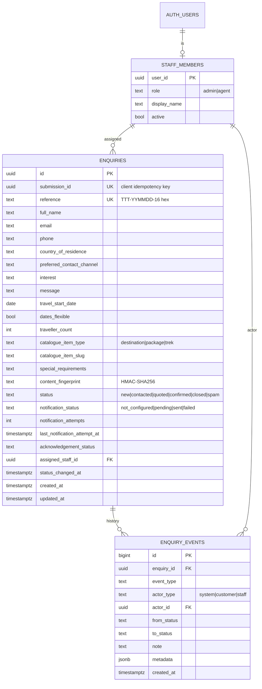

# Database Design

Postgres on Supabase. Migrations live in `supabase/migrations/` and are **additive only**.

| Migration | Purpose |
| --- | --- |
| `20261031000000_create_enquiries.sql` | Existing: `enquiries`, `enquiry_rate_limits`, `consume_enquiry_rate_limit`. |
| `20261101000000_backend_platform.sql` | New: catalogue association, special requirements, fingerprint, notification tracking, `staff_members`, `enquiry_events`, triggers, staff RPCs. |

The new migration uses `add column if not exists` / `create table if not exists`, drops nothing, and backfills nothing. Existing rows get `NULL` or safe defaults (`notification_attempts = 0`, `acknowledgement_status = 'not_configured'`).

## Entity diagram



## Constraints

- Catalogue type and slug must both be set or both be null (`enquiries_catalogue_item_pair`); slug is kebab-case, at most 120 characters.
- `content_fingerprint` must be 64 lowercase hex characters.
- Notes are 1–2000 characters; event types are a closed enum.

## Triggers and functions

| Object | Behaviour |
| --- | --- |
| `enquiries_track_notification_attempts` (before) | Increments `notification_attempts` and stamps `last_notification_attempt_at` whenever a row enters `pending`. |
| `enquiries_record_events` (after) | Writes `created` and every `notification_*` transition into `enquiry_events`. |
| `change_enquiry_status(ref, from, to, actor, note)` | Compare-and-set status update plus audit event in one transaction. Returns `updated`, `conflict` or `not_found`. |
| `add_enquiry_note(ref, actor, note)` | Appends a `note_added` event. Returns `added` or `not_found`. |

All functions use `set search_path = ''` and are executable by `service_role` only.

## Applying the migration

```bash
supabase db push            # or paste the SQL into the Supabase SQL editor
```

Then add staff (replace the UUID with the Supabase Auth user id):

```sql
insert into public.staff_members (user_id, role, display_name)
values ('00000000-0000-0000-0000-000000000000', 'admin', 'Office Admin');
```

## Backup and recovery requirements

- Enable Point-in-Time Recovery (Pro plan) with at least 7 days of retention for production.
- Daily logical backups are retained by Supabase. Run a restore drill to a branch project before launch and record the time it takes.
- `enquiry_events` is append-only by convention. Do not grant `update`/`delete` on it to application code paths.
- Rollback for this migration is forward-only: new columns are nullable or defaulted, so older application code keeps working if a deploy is reverted.
