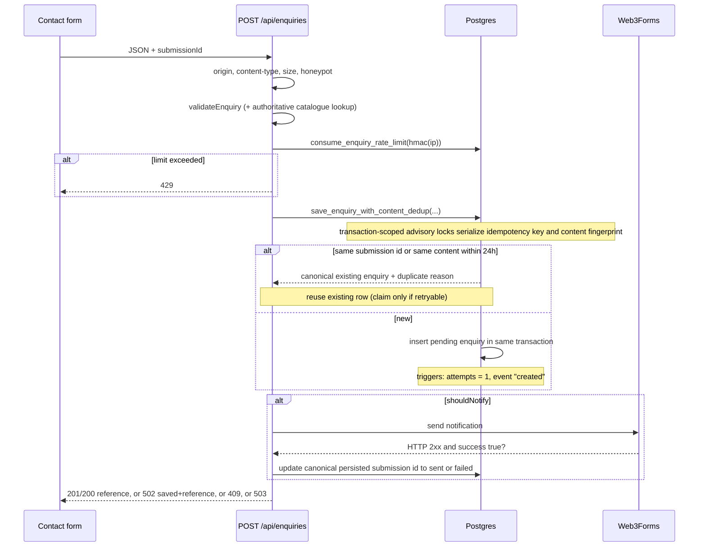
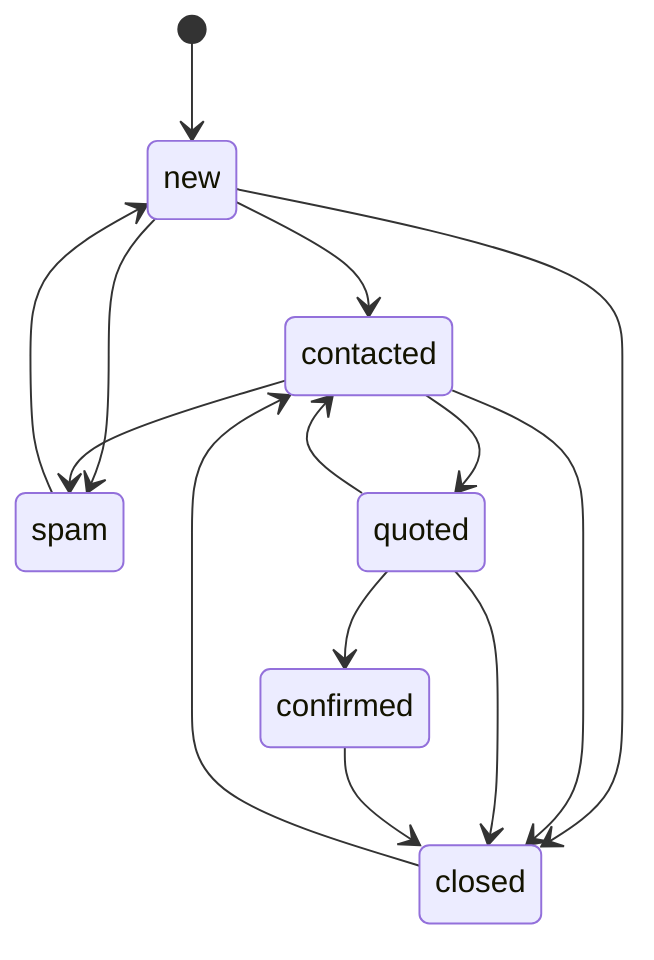

# Enquiry Workflow

## Submission sequence

## Guarantees

1. **No false success.** `201/200` is returned only after the row exists **and** Web3Forms returned `success: true`.
2. **No lost leads.** The row is written before notification; a provider failure returns `502` with the saved reference.
3. **Atomic duplicate suppression.** `save_enquiry_with_content_dedup` runs in one Postgres transaction. Transaction-scoped advisory locks serialize both the client submission ID and normalized content fingerprint before checking/inserting. Concurrent submissions with the same fingerprint therefore cannot both insert.
4. **Correct notification ownership.** Notification status updates use the canonical persisted row's `submission_id`, not the ID from a later request that was suppressed as a content duplicate.
5. **No duplicate emails from retries.** The same `submissionId`, or the same content within 24 hours, maps to the existing enquiry. Notification is only re-attempted when the existing row is `failed`, `not_configured` or a `pending` row older than the 2-minute lease, and the claim is a compare-and-set on `(notification_status, updated_at)` so two concurrent retries cannot both send.
6. **Audit trail.** Creation, every notification state change, duplicate suppression, retry requests, staff status changes and notes are recorded in `enquiry_events`.

## Status lifecycle (staff-managed)

`confirmed` means the customer agreed to a quote. It is not a payment or booking guarantee.

## Notification lifecycle

`pending -> sent` or `pending -> failed`. `failed`, `not_configured` and stale `pending` rows can be re-claimed to `pending` by a customer retry or by an admin calling `notification-retry`.

## Spam and abuse controls

- Hidden honeypot field `website`.
- Per-IP rate limit: 5 submissions per 15 minutes, keyed by an HMAC of the IP (raw IPs are never stored).
- Same-origin check and a 16 KB body limit.
- Content fingerprint duplicate suppression.
- Staff can mark enquiries `spam`; spam rows are excluded from duplicate matching.

## Customer acknowledgement

The `acknowledgement_status` column exists (default `not_configured`) but **no acknowledgement email is sent yet**. Sending to customers requires an authorised sending domain and explicit approval; see Known limitations in `BACKEND-AUDIT.md`. The UI must not tell customers they will receive a confirmation email.
